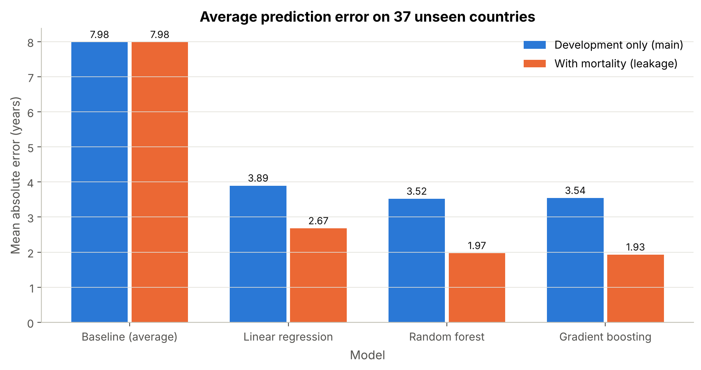
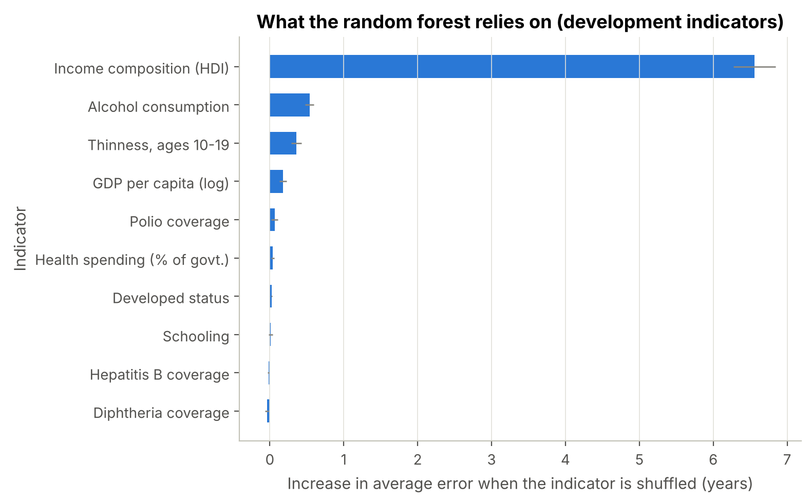
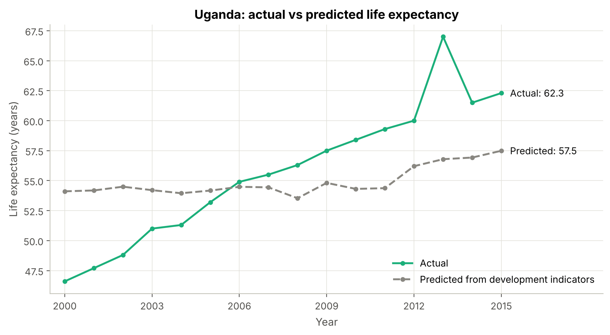

# Predicting Life Expectancy from Development Indicators

**How well can a country's development indicators predict its life expectancy, and which ones matter most?**

Machine-learning models trained on WHO data for 183 countries (2000–2015) and tested on countries they have never seen. The project also shows a common trap, **target leakage**: adding mortality indicators makes the scores look much better, but only because life expectancy is calculated from death rates.

<a href="https://colab.research.google.com/github/ekoudavid/life-expectancy-prediction/blob/main/notebooks/life_expectancy_modelling.ipynb"></a>

---

## Key results

Average prediction error on **37 held-out countries** (none of their data was used in training):

| Model | Development indicators only (main) | With mortality indicators (leakage) |
|---|---|---|
| Baseline: predict the average | 7.98 years | 7.98 years |
| Linear regression | 3.89 years (R² 0.69) | 2.67 years (R² 0.86) |
| Random forest | **3.52 years (R² 0.76)** | 1.97 years (R² 0.92) |
| Gradient boosting | 3.54 years (R² 0.75) | 1.93 years (R² 0.93) |



**Findings**

1. **Development indicators alone predict life expectancy to within about 3.5 years** for countries the model has never seen, less than half the error of guessing the average. Five-fold grouped cross-validation gives a consistent 3.13 ± 0.49 years.
2. **The mortality version's better scores are target leakage, not a better model.** Its inputs (adult mortality, child deaths, HIV/AIDS deaths) are ingredients of the life expectancy calculation. The ~1.5-year gap shows how much leakage inflates performance.
3. **Income composition (a Human Development Index measure) dominates.** Shuffling it raises the error by about 6.6 years. Schooling ranks low only because it almost duplicates income composition (r = 0.92), not because it is unrelated to life expectancy (r = 0.77).
4. **The biggest errors are in countries with a heavy disease burden.** The model over-predicts life expectancy for Tanzania, Malawi, Swaziland and the DR Congo, several of which had very high HIV/AIDS mortality that development indicators do not capture.
5. **Uganda's gain is not explained by development indicators.** Trained on every other country, the model predicts a nearly flat ~54 years for Uganda between 2000 and 2011, while actual life expectancy rose from 46.6 to 59.3. This is consistent with health-specific progress such as HIV treatment scale-up, which this dataset cannot measure directly.

| What the main model relies on | Uganda: actual vs predicted |
|---|---|
|  |  |

---

## Approach

- **Data cleaning** (`src/data_prep.py`): standardised names; removed 10 countries with a single year of data; set 1,015 impossible values to missing (e.g. death rates above 1,000 per 1,000, zero years of schooling); treated 150 alcohol values of 0.01 litres as missing-value codes; dropped four unreliable columns (population, BMI, percentage expenditure, measles); filled gaps from each country's neighbouring years.
- **No leakage between countries:** the remaining gaps are filled *inside* each model pipeline using training countries only.
- **Split by country, not by row:** each country appears 16 times with near-identical rows, so a random row split would let the model memorise countries. 20% of countries are held out as the test set, and cross-validation uses grouped folds.
- **Models:** baseline (predict the average), linear regression, random forest, gradient boosting (scikit-learn).
- **Evaluation:** mean absolute error (MAE, in years), root mean squared error (RMSE) and R².
- **Interpretation:** permutation importance on the test countries, error analysis by country, and a leave-Uganda-out case study.

## Data

[Life Expectancy (WHO)](https://www.kaggle.com/datasets/kumarajarshi/life-expectancy-who) on Kaggle, compiled from the WHO Global Health Observatory and United Nations economic data: 2,938 rows, 22 columns, 193 countries, 2000–2015. The original file is included in `data/`.

## Repository structure

```
├── data/
│   └── Life Expectancy Data.csv             # original Kaggle file, unchanged
├── figures/                                  # charts produced by the notebook
├── notebooks/
│   └── life_expectancy_modelling.ipynb       # the full analysis, with outputs
├── src/
│   └── data_prep.py                          # reusable, documented cleaning pipeline
├── requirements.txt
└── README.md
```

## How to run

**In Google Colab:** click the *Open in Colab* button above and choose *Runtime → Run all*. The first cell downloads the data and code automatically.

**Locally:**
```bash
git clone https://github.com/ekoudavid/life-expectancy-prediction.git
cd life-expectancy-prediction
pip install -r requirements.txt
jupyter notebook notebooks/life_expectancy_modelling.ipynb
```
All results are reproducible: random seeds are fixed at 42.

## Limitations

- **GDP is very noisy** in the source data (953 year-to-year jumps of more than five-fold within a country), so its role should be read with caution.
- **Alcohol placeholders** were identified with a rule (0.01 litres in a country that typically drinks more than 0.5), not confirmed against the original source.
- **The data ends in 2015** and describes national averages: the results are associations, not causes, and may not apply to individuals.
- **Some recorded values are implausible** but were kept as reported because they could not be verified, such as Uganda's isolated 2013 life expectancy of 67.0 years.

## Possible next steps

- Add **HIV prevalence and antiretroviral treatment coverage** (UNAIDS) as legitimate, non-leaking health indicators.
- Rebuild with **more recent WHO and World Bank data** (to 2021), including the COVID-19 period.
- Tune the tree models and test whether the ranking of indicators holds.

---

**Author:** David Ekou, MEAL Officer and data analyst, Kampala, Uganda.
